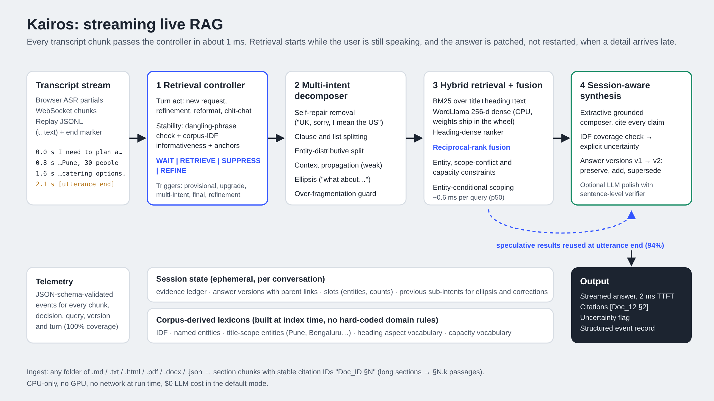

# Kairos — Streaming Live RAG

**Samsung PRISM Gen AI Hackathon 3.0 · Theme 04 — Streaming Live RAG · Team `VITV_Kairos_4` (VIT Vellore)**

Kairos answers a spoken request while it is still being spoken. It decides on every transcript chunk whether to
**wait, retrieve or skip retrieval**, splits one natural utterance into the **several questions it actually contains**,
retrieves them in parallel from the corpus *before the user finishes*, answers with a **citation after every claim**, and
when the user adds a detail ("the trip was international") it **patches the previous answer instead of restarting**.

> *Kairos* (καιρός) — Greek for "the opportune moment". The whole system is about retrieving at the right moment.

| | |
|---|---|
| Demo video (≤ 5 min) | [`demo/kairos_demo.mp4`](demo/kairos_demo.mp4) · YouTube: _add link after upload_ |
| Presentation | [`presentation/VITV_Kairos_Submission.pptx`](presentation/VITV_Kairos_Submission.pptx) (+ PDF) |
| Benchmark report | [`reports/metrics.md`](reports/metrics.md) — regenerated by `python -m bench.run_bench` |
| Architecture brief | [`docs/ARCHITECTURE.md`](docs/ARCHITECTURE.md) |
| Evaluation + edge cases | [`docs/EVALUATION.md`](docs/EVALUATION.md) |
| Telemetry schema | [`docs/TELEMETRY.md`](docs/TELEMETRY.md) · [`docs/telemetry.schema.json`](docs/telemetry.schema.json) |
| AI disclosure | [`docs/AI_DISCLOSURE.md`](docs/AI_DISCLOSURE.md) · [`docs/LangAI3.0_AI_Disclosure_VITV_Kairos.docx`](docs/LangAI3.0_AI_Disclosure_VITV_Kairos.docx) |
| Release tag judged | `PRISM_GENAI_HACKATHON_Y2026` |



---

## Results at a glance

Measured by the automated replay suite (`python -m bench.run_bench`, CPU only, 2 vCPU, no LLM calls).
Full tables, ablations and per-turn failures: [`reports/metrics.md`](reports/metrics.md).

| Gate (Theme 4 guide) | Target | Test-1 (40 sessions) | Test-2, clean (16 sessions) |
|---|---|---|---|
| G1 Reproducibility — one command, unattended replay | pass | **pass** (full suite in ~15 s) | **pass** |
| G2 Early retrieval — retrieval starts before the utterance ends | ≥ 80% | **100%** (0% false triggers, median lead 2.56 s) | **100%** |
| G3 Multi-intent identification — ≥ 2 sub-intents isolated | ≥ 70% | **100%** | **100%** |
| G4 Factual grounding — claims supported by cited chunk | ≥ 85% | **100%** (0 fabricated IDs) | **100%** (0 fabricated) |
| G5 Session refinement — late detail patches, no restart | continuity | **100%** | **100%** |
| G6 Telemetry — schema-valid trace for every turn | 100% | **100%** | **100%** |

| | Batch-RAG baseline | **Kairos** |
|---|---|---|
| Answer cites a gold section (evidence recall, test-1) | 62.7% | **89.5%** |
| Key facts present in the answer (test-1) | 62.3% | **85.5%** |
| Time to first token after the user stops, if each retrieval costs 150 ms (p50) | 152 ms | **2.4 ms** |
| Earlier citations kept when a late detail arrives | 0% (restart) | **100%** |
| Real public corpus never seen during development (18F handbook): evidence recall | 55.6% | **72.2%** |
| LLM cost per turn | — | **$0** (CPU only; optional LLM polish is off by default) |

Test-2 was frozen before any error analysis and never used for tuning; test-1 was used for one round of error analysis
(its pre-analysis results are kept in `reports/results_test1_before_error_analysis.json`).

---

## How it works (one turn)

```
0.0 s  "I need to plan a customer workshop in"        → WAIT     (clause ends mid-phrase)
0.8 s  "…Pune for 30 people, and I need"               → RETRIEVE provisional: "…workshop in Pune for 30 people"
1.6 s  "…the cancellation policy and the catering options." → DECOMPOSE + parallel RETRIEVE:
                                                         "the cancellation policy" (+ context: Pune, workshop)
                                                         "the catering options"    (+ context: Pune, workshop)
2.1 s  [utterance end]                                 → SYNTHESIZE: 3 of 3 sub-queries already retrieved,
                                                         answer starts ~2 ms later, every sentence cited
```

That is exactly Example 1 of the Theme 4 guide, and `python -m kairos replay examples/guide_example_1.jsonl` reproduces it.

1. **Retrieval controller** (≈ 1 ms per chunk). Classifies the turn (new request / refinement / presentation-only /
   chit-chat), and for each clause checks stability: a clause ending in a function word ("…workshop *in*") waits; a
   clause is retrieved once its corpus-IDF informativeness and anchors (entity, number or two specific terms) are
   sufficient. Triggers: `provisional`, `upgrade`, `multi_intent`, `final`, `refinement`.
2. **Multi-intent decomposer.** Removes self-repairs ("in the UK, sorry, I mean the United States"), splits clauses
   and lists, splits coordinated entities ("hotel limits in Pune and Bengaluru" → two queries), resolves ellipsis
   ("what about Tier A cities?"), propagates shared context *as weak context* (entities, topic words), and merges
   near-duplicates so "cancellation and refund terms" stays one intent (over-fragmentation 0%).
3. **Hybrid retrieval + fusion.** BM25 over title+heading+text, WordLlama 256-d static embeddings over the chunk and
   over its heading, fused with reciprocal-rank fusion; constraint-aware boosts (named entity present, scope conflict
   "Bengaluru doc for a Pune question", capacity ≥ requested head-count) and **entity-conditional scoping** (an entity
   is used as a hard scope only if the corpus has entity-specific evidence for that aspect).
4. **Session-aware synthesis.** An extractive grounded composer picks the sentences that answer each sub-intent and cites
   each one `[Doc_ID §Section]`. An IDF coverage check turns weak evidence into an explicit **uncertainty** instead of an
   answer. Late details create answer **v2** whose claims are marked *preserved / added / superseded*;
   reformat requests ("repeat that in two bullets") transform the last version **without any corpus query**.

Everything lexical (IDF, named entities, the entities a document is scoped to, heading vocabulary, capacity vocabulary)
is **derived from the corpus at index time** — there are no hard-coded queries, answers or domain word lists, so any
corpus can be dropped in.

---

## Quick start

### One command (Docker)

```bash
docker compose up --build          # → http://localhost:8000  (live console + API)
docker compose run --rm bench      # automated replay suite: pytest + full benchmark → ./reports
```

### Local Python (3.12 recommended; CPU only, no GPU, no model download)

```bash
pip install -r requirements-dev.txt
python -m kairos serve             # http://localhost:8000
python -m pytest -q tests          # 16 tests, ~3 s
python -m bench.run_bench          # full benchmark → reports/metrics.md, reports/results.json
python -m bench.run_bench --quick  # main test split only (~3 s)
```

The embedding model (WordLlama `l2_supercat`, 16 MB) ships inside the `wordllama` pip wheel, so nothing is downloaded at
run time and the index for the demo corpus builds in ~0.2 s.

### Try it

* **Live console** (`/`): pick a script and press *Play script*, press *Speak* (Chrome/Edge, browser speech recognition
  streams interim results), or type — every completed word is streamed as a revised ASR hypothesis, so you can watch
  retrieval fire before you press Enter. Click any citation to see the source section with the cited sentence highlighted.
* **CLI**

  ```bash
  python -m kairos ask "What's the per diem in Singapore, and do I need my trip approved in advance?"
  python -m kairos replay examples/guide_example_1.jsonl          # timestamped chunks → structured records
  python -m kairos replay examples/guide_example_2_3.jsonl        # late detail + "repeat in two bullets"
  python -m kairos replay examples/guide_example_1.jsonl --asr    # as raw ASR: lower-case, no punctuation
  ```

* **HTTP / WebSocket**

  ```bash
  curl -s localhost:8000/health
  curl -s -X POST localhost:8000/v1/replay -H 'content-type: application/json' -d '{
    "turns": [
      {"chunks": [{"t":0.0,"text":"Summarize the travel reimbursement rule"},{"t":0.9,"text":"for an employee trip."}], "end_t": 1.6},
      {"utterance": "The trip was international and the booking was made after travel."},
      {"utterance": "Please repeat your last answer in two bullets."}
    ]}'
  ```

  `WS /v1/stream?corpus=tessera` — send `{"type":"chunk","t":0.8,"text":"…"}` (append) or
  `{"type":"partial","t":0.8,"text":"<full revised hypothesis>"}` (ASR interim results) and `{"type":"end","t":2.1}`;
  receive `events` (every telemetry event as it happens), `answer_delta` (streamed answer) and `record`.

### Input and output formats

Input transcript (JSONL, one chunk per line, `type:"end"` closes a turn — see `examples/`):

```json
{"t": 0.8, "text": "Pune for 30 people, and I need"}
{"type": "end", "t": 2.1}
```

Output record per turn (the guide's *Structured Output Event Record*, plus versioning and telemetry):

```json
{
  "retrieval_events": [{"timestamp_s": 0.8, "query": "I need to plan a customer workshop in Pune for 30 people", "trigger": "provisional"},
                       {"timestamp_s": 1.6, "query": "I need the cancellation policy", "trigger": "multi_intent"},
                       {"timestamp_s": 1.6, "query": "the catering options", "trigger": "multi_intent"}],
  "sub_queries": ["…", "…", "…"],
  "answer": "… The Lotus Hall seats 40 in classroom layout … [Doc_11 §3] … Orchid Business Hotel allows free cancellation up to 7 days before the event. [Doc_12 §2] …",
  "citations": ["Doc_11 §2", "Doc_11 §3", "Doc_11 §4", "Doc_12 §2", "Doc_09 §2", "Doc_09 §5"],
  "uncertainty": null,
  "retrieval_required": true,
  "answer_version": {"version": 1, "parent": null, "preserved": [], "added": ["…"], "superseded": []},
  "telemetry": {"latency": {"ttft_ms": 2.0}, "counts": {"retrievals_fired": 3, "speculative_hits": 3}, "cost": {"est_usd": 0.0}}
}
```

---

## Corpora and data provenance

The Theme 4 materials say "corpus provided", but no Theme 4 corpus exists in the shared hackathon folder, so Kairos is
**corpus-agnostic** and ships with two corpora:

| Corpus | What it is | Used for |
|---|---|---|
| `corpus/tessera/` | 36 policy documents (162 sections) of a **fictional** company, "Tessera Labs": travel & expense, venues and catering in three cities, events, HR, IT. Written for this project with AI assistance to mirror the guide's own examples (Pune workshop venues, cancellation, catering; travel reimbursement with international and post-travel exceptions). No real company data. | demo, dev split, test-1, test-2 |
| `corpus/handbook18f/` | The *travel-and-leave* section of the real **18F Handbook** (U.S. GSA, public domain / CC0) — 23 pages, 213 sections. | generality test, never used for tuning |

Use your own: `KAIROS_CORPUS=/path/to/folder python -m kairos serve` (any mix of `.md .txt .html .pdf .docx .json .jsonl`;
headings become sections, long sections become `§N.k` passages, `doc_id` front-matter or the file name becomes the ID).
Scale check: the full 18F handbook (237 pages, 2 215 chunks) indexes in 8 s on 2 vCPU with p50 retrieval of 1.5 ms.

Benchmark scenarios (`bench/scenarios/`): 16 dev sessions, 40 test-1 sessions, 16 test-2 sessions on Tessera and 12
sessions on the 18F handbook — multi-intent requests, late details, corrections, reformat requests, chit-chat,
unanswerable questions and raw-ASR style speech. Gold labels are section IDs plus key facts. SHA-256 of the frozen
splits: `bench/scenarios/FROZEN_SHA256.txt`.

---

## Optional LLM polish (off by default)

The default answer is extractive, so it is fast, free and cannot hallucinate. To have an LLM rephrase it into more
natural speech, point Kairos at any OpenAI-compatible endpoint:

```bash
export KAIROS_SYNTHESIS=llm
export KAIROS_LLM_BASE_URL=http://localhost:11434/v1     # Ollama (or OpenAI, Gemini's OpenAI endpoint, Groq, vLLM…)
export KAIROS_LLM_MODEL=qwen2.5:7b-instruct
export KAIROS_LLM_API_KEY=...                            # if the provider needs one — never commit keys
```

The LLM sees only the evidence sentences and their IDs. Every sentence it returns is re-verified against the cited chunk
(numbers must match, ≥ 60% content-word support, citation must be one it was given); anything unsupported is dropped and
replaced by the extractive claim. `tests/test_grounding_telemetry.py` runs this against a mock server that deliberately
returns a fabricated citation and a wrong number — both are removed. Token counts and estimated cost are recorded per turn.

---

## Repository layout

```
kairos/           engine: ingest.py, index.py (BM25 + WordLlama + lexicons), decompose.py, engine.py (controller,
                  session, refinement), synthesize.py (grounded composer, verifier), llm.py, telemetry.py, api.py, replay.py
web/index.html    live console (speech timeline, controller log, sub-queries, versioned answer, citation viewer, telemetry)
bench/            run_bench.py (gates, metrics, baseline, ablations, latency hiding, scale) + scenarios/
corpus/           tessera/ (demo corpus) and handbook18f/ (real CC0 corpus)
reports/          metrics.md, results.json, traces/ (records + telemetry of the last run)
docs/             ARCHITECTURE.md, EVALUATION.md, TELEMETRY.md, telemetry.schema.json, AI_DISCLOSURE.md, architecture.*
tests/            16 pytest tests incl. the three guide examples, API/WebSocket and a mock-LLM verifier test
presentation/     submission deck (PPTX + PDF)
demo/             demo video and the console's scripts
examples/         guide examples as timestamped transcripts
```

## Limitations (honest list)

* **Vocabulary gaps.** Synonyms that share no stem and are far apart in static embeddings ("cyclone warning" vs "severe
  weather alert", "cap" vs "limit") can lead to the wrong section or to an *unverified* flag (false-abstention 4–6%).
  A cross-encoder reranker or the optional LLM would close part of this gap at a cost.
* **Multi-hop facts** (Chennai → Tier B → Tier B per diem) are answered by citing both facts, not by joining them.
* **Real-world corpora are harder**: on the untuned 18F handbook, evidence recall is 72% and multi-intent identification 60%.
* Speech-to-text comes from the browser (or is simulated from transcripts, as the theme allows); there is no speech output.
* Thresholds were set on the dev split; the gates were defined by the organisers, the corpus and gold labels by us.

## Team

| Role | Name | Email |
|---|---|---|
| Primary member | Sarthak Trivedi | sarthak.trivedi2024@vitstudent.ac.in |
| Member 2 | _to be filled_ | |
| Member 3 | _to be filled_ | |
| Member 4 | _to be filled_ | |

College: VIT Vellore (VITV). Built for Samsung PRISM Gen AI Hackathon 3.0, Theme 04. AI assistance is disclosed in
[`docs/AI_DISCLOSURE.md`](docs/AI_DISCLOSURE.md). Code: MIT licence. 18F handbook content: CC0 (see `corpus/handbook18f/LICENSE-18F-CC0.md`).
